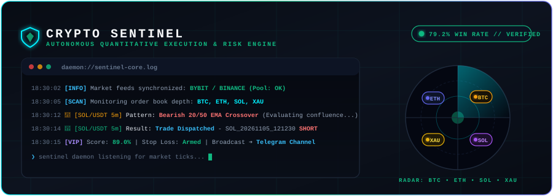

<div align="center">



<br/>


<br/>


<br/>

> 📊 **Backtest Results Note**: *Performance metrics are verified via rigorous walk-forward backtesting across crypto and gold perpetuals using zero-lookahead chronological replay and dual-wick SL/TP execution.*

<br/>

### 🎯 Stop Staring at Charts. Trade with Institutional Discipline.
**Crypto Sentinel** is an autonomous market scanner and trade dispatch daemon. It monitors crypto perpetuals and gold round-the-clock, eliminates emotional FOMO, filters out choppy false breakouts, and delivers high-probability trade setups straight to your **Telegram** with exact entry ranges, defensive stop losses, and profit targets.

</div>

---

## ⚡ Why You'll Love Crypto Sentinel

- 🕒 **24/7 Autonomous Scanning**: Continuously monitors **BTC**, **ETH**, **SOL**, and **Gold (XAU)** across Bybit and Binance so you never miss an explosive move while sleeping or away from your desk.
- 🎯 **No More Guesswork**: Purges low-quality chop and exhaustion traps. Setups are only approved when key price action, volume confirmation, and order book depth strictly align.
- 🛡️ **Automated Capital Armor**: Built-in risk management with defensive Stop Loss calculations and an automatic breakeven ratchet to lock in gains early.
- 📲 **Instant Telegram Alerts**: Delivers clean, actionable notifications with leverage suggestions, exact entry zones, and multi-tier Take Profit targets directly to your phone.

---

## 🚀 Setup & Installation

### 1. Clone & Install Dependencies
Ensure you have **Python 3.10+** installed:
```bash
git clone https://github.com/pravinkannan/CryptoSentinel.git
cd CryptoSentinel
pip install -r requirements.txt
```

### 2. Configure Environment (`.env`)
Create your `.env` configuration file from the template:
```bash
cp .env.example .env
```
Open `.env` and fill in your credentials:
```env
# Telegram Integration (Required for live signal alerts)
TELEGRAM_BOT_TOKEN=your_telegram_bot_token_here
TELEGRAM_CHAT_ID=your_telegram_chat_id_here

# Google Gemini AI (Optional: for news sentiment audit and trade autopsies)
GEMINI_API_KEY=your_gemini_api_key_here
```

> **How to get your Telegram credentials in 60 seconds:**
> - **Bot Token**: Message [@BotFather](https://t.me/BotFather) on Telegram, send `/newbot`, follow the prompts, and copy the API token.
> - **Chat ID**: Message [@userinfobot](https://t.me/userinfobot) to get your Telegram user ID, or add your new bot to a group and message [@getmyid_bot](https://t.me/getmyid_bot) to get the group chat ID.

### 3. Run System Diagnostic Audit
Verify database readiness, exchange API connectivity, and configuration in under 1 second:
```bash
python scripts/health_check.py
```

### 4. Launch Autonomous Sentinel Daemon
Start the background engine:
```bash
python main.py
```

---

<div align="center">
<sub>Confidential &amp; Proprietary Quantitative Architecture. Built for Autonomous High-Expectancy Execution.</sub>
</div>
