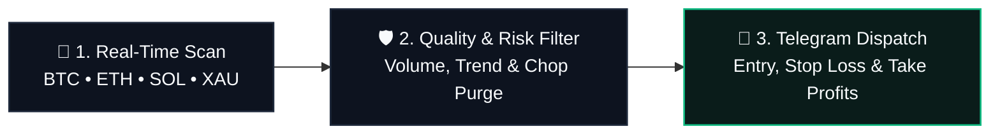

<div align="center">


<br/>


<br/>

**Crypto Sentinel** is an institutional-grade algorithmic execution and capital preservation engine.  
It monitors crypto perpetuals and gold 24/7, continuously filtering market noise to dispatch high-conviction trade setups directly to Telegram.

</div>

---

### 💡 How It Works

Crypto Sentinel automates the entire trade lifecycle in three simple, transparent stages:



1. **Continuous Market Ingestion**: Scans Level-2 order book depth, volume profiles, and momentum across top liquid assets (**BTC**, **ETH**, **SOL**, and **Gold / XAU**) on Bybit and Binance with seamless automatic exchange failover.
2. **Deterministic Quality Filtration**: Rejects low-probability setups, ranging chop, and RSI exhaustion traps. A trade is only approved when trend direction, order book imbalances, and volume expansion strictly align.
3. **Automated Capital Armor**: Every trade includes a strict defensive Stop Loss, multi-tier Take Profit targets, and an automated breakeven ratchet to lock in profits early. Qualified setups are immediately dispatched to your private Telegram channel.

---

### 🚀 Quickstart & Setup Guide

#### 1. Clone & Install Dependencies
Ensure you have **Python 3.10+** installed:
```bash
git clone https://github.com/pravinkannan/CryptoSentinel.git
cd CryptoSentinel
pip install -r requirements.txt
```

#### 2. Configure Environment (`.env`)
Create a `.env` file in the root directory by copying the example:
```bash
cp .env.example .env
```
Open `.env` and fill in your credentials:
```env
# Telegram Integration (Required for live signal alerts)
TELEGRAM_BOT_TOKEN=your_telegram_bot_token_here
TELEGRAM_CHAT_ID=your_telegram_chat_id_here

# Google Gemini AI (Optional: for news sentiment audit and trade autopsies)
GEMINI_API_KEY=your_gemini_api_key_here
```

> **How to get your Telegram credentials:**
> - **Bot Token**: Open Telegram, search for [@BotFather](https://t.me/BotFather), send `/newbot`, follow the prompts, and copy the API token.
> - **Chat ID**: Message [@userinfobot](https://t.me/userinfobot) to get your Telegram user ID, or add your new bot to a group and message [@getmyid_bot](https://t.me/getmyid_bot) to get the group chat ID.

#### 3. Run System Diagnostic Audit
Verify that your database, exchange APIs, and configuration are 100% operational (completes in ~0.5s):
```bash
python scripts/health_check.py
```

#### 4. Launch Autonomous Sentinel Daemon
Start the live background daemon:
```bash
python main.py
```

---

### 🎮 Telegram Bot Operator Commands

Control and inspect the sentinel directly from your Telegram chat:

| Command | Action |
| :--- | :--- |
| `/status` | Live daemon uptime, active paper positions, and portfolio drawdown telemetry. |
| `/recon <sym>` | Dispatches an on-demand multi-timeframe structural recon scan (e.g. `/recon SOL`). |
| `/nearmiss` | Audits candidate setups that just missed the high-conviction dispatch threshold. |
| `/autopsy <id>` | Inspects forensic post-mortem analysis for any closed paper position. |

---

<div align="center">
<sub>Confidential &amp; Proprietary Quantitative Architecture. Built for Autonomous High-Expectancy Execution.</sub>
</div>
