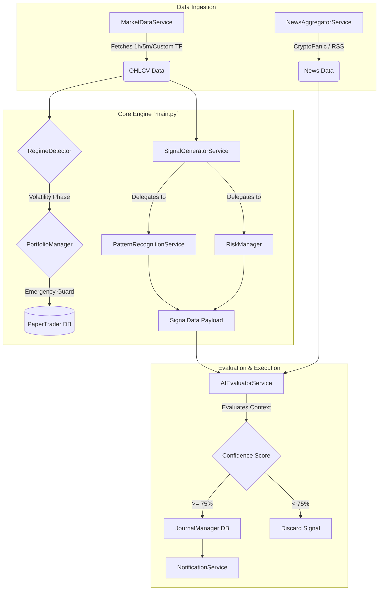

# 01 - System Architecture

Crypto Sentinel is a highly decoupled, asynchronous algorithmic trading engine built in Python. Its architecture relies on Domain-Driven Design (DDD) to cleanly separate market data ingestion, technical analysis, AI risk evaluation, and database persistence.

## High-Level Execution Pipeline

The core execution loop resides in `main.py`, which acts as the Dependency Injection (DI) container. The loop is entirely non-blocking, utilizing `asyncio` and `aiosqlite`.

## Component Breakdown

### 1. `main.py` (The Async Orchestrator)
Initializes all service classes (e.g., `MarketDataService`, `AIEvaluatorService`). It loops over user-defined tickers and timeframes. Because it relies heavily on `await`, multiple tickers can be processed concurrently without I/O blocking from API requests or Database writes.

### 2. `core/` (Configurations and Models)
- **`config.py`**: Uses Pydantic `BaseSettings` to enforce types and validate environment variables (like API keys, thresholds, and leverage constraints).
- **`models.py`**: Contains strict Pydantic schemas like `SignalData`. This ensures that when the `SignalGeneratorService` passes data to the `AIEvaluator`, there are zero missing dictionary keys.

### 3. `data/` (Data Ingestion)
- **`market_data_service.py`**: Connects to the exchange (e.g., Binance, Bybit) using `ccxt`. Fetches OHLCV and market microstructure data like Funding Rates and Order Book Imbalances.
- **`news_aggregator.py`**: Pulls recent global macroeconomic and crypto-specific news.

### 4. `engine/` (The Brain)
- **`regime_detector.py`**: Determines if the market is trending, consolidating, or undergoing a violent volatility shock.
- **`signal_generator.py`**: A dispatcher that uses `pandas-ta` to compute indicators, then delegates logic to sub-services.
- **`pattern_recognition.py`**: Scans for candlesticks, Fair Value Gaps (FVGs), and momentum setups.
- **`risk_manager.py`**: Computes Stop-Loss distances based on ATR (Average True Range) and determines mathematically safe leverage values.
- **`ai_evaluator.py`**: The Gemini LLM wrapper that synthesizes technical and fundamental data into a final trade verdict.

### 5. `execution/` (Simulated Persistence)
- **`paper_trader.py`**: Async SQLite manager tracking active simulations. It calculates Maximum Adverse Excursion (MAE) and Maximum Favorable Excursion (MFE), and handles trailing stop-losses.
- **`journal_manager.py`**: Async SQLite logger tracking statistical outcomes to calculate "Pattern Drift" (if a specific pattern stops working over time).
