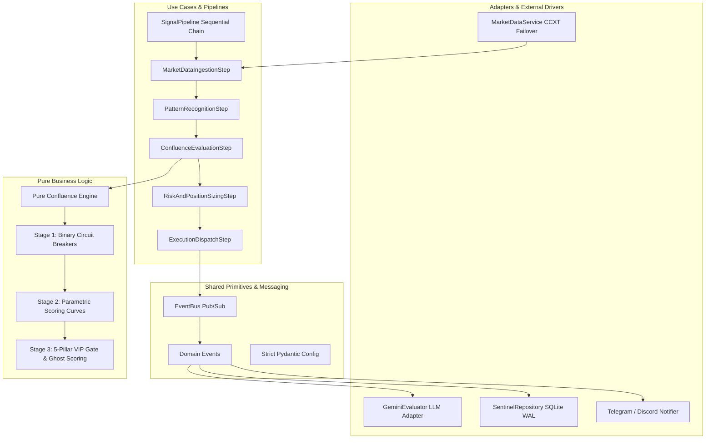

# 01 - System Architecture & Hexagonal Decoupling

Crypto Sentinel is an institutional-grade, asynchronous quantitative trading engine built on **Hexagonal (Ports & Adapters) and Event-Driven Architecture**. Its design cleanly isolates pure mathematical trading domain rules from external infrastructure adapters, persistence layers, and application use-case pipelines.

---

## 🏛️ Architecture Overview

The system is organized into four concentric architectural layers:

---

## 📂 Layer Breakdown & Folder Responsibilities

### 1. `domain/` (Pure Business Logic)
- **Role**: Contains the heart of Sentinel's proprietary quantitative models. It has **zero dependencies on external libraries**, zero network calls, zero LLM prompts, and zero I/O operations.
- **Key Modules**:
  - `domain/confluence/engine.py`: Deterministic scoring logic:
    - **Stage 1 Circuit Breakers**: 4H macro trend conflict purge, RSI exhaustion trap ($>75$ Long / $<25$ Short), and anemic volume filter ($<0.55\times$ SMA). Includes the 1.5x volume counter-trend reversal bypass.
    - **Stage 2 Parametric Curves**: Continuous mathematical point scoring for dynamic volume, key level proximity, state-aware Session VWAP (+4.0%), order book defensive shields, BTC beta macro correlation, and -5.0% exhaustion absorption trap.
    - **Stage 3 VIP 5-Pillar Gate**: Enforces 5 strict institutional mandates for $\ge 92.0\%$ VIP qualification.
    - **Ghost Scoring**: Computes full decimal scoring even when circuit breakers trip for telemetry and near-miss audits.
    - **Dual-Regime Dispatch Floor**: Dynamic 80.0% confidence floor for confirmed reversal setups vs. 86.0% standard floor.

### 2. `application/` (Use Cases & Pipeline Orchestration)
- **Role**: Implements the workflows and execution pipelines of the application. It receives inputs from adapters and delegates domain evaluation.
- **Key Modules**:
  - `application/pipeline/pipeline.py`: Defines the `IPipelineStep` protocol, the `SignalContext` data carrier, and the sequential `SignalPipeline` executor.
  - `application/pipeline/steps.py`: Five discrete, testable steps:
    1. **`MarketDataIngestionStep`**: Ingests multi-timeframe candles, validates data freshness via the Heartbeat Watchdog, detects volatility regimes, and triggers pending trade updates on the primary timeframe.
    2. **`PatternRecognitionStep`**: Evaluates dynamic pivot/psychological levels, order book microstructure, and scans candlestick setups.
    3. **`ConfluenceEvaluationStep`**: Delegates quantitative evaluation to `domain/confluence/engine.py`, coordinates LLM narrative validation, handles active opposing position threat modes (defensive SL ratchet to BE), and bias flips.
    4. **`RiskAndPositionSizingStep`**: Computes tier-calibrated dynamic leverage, ATR buffers, take profit targets (TP1/TP2), same-direction deduplication, and adverse funding rate filters.
    5. **`ExecutionDispatchStep`**: Persists trades to the repository, emits `TradeOpenedEvent` to the Event Bus, and broadcasts alerts via Telegram/Discord.

### 3. `infrastructure/` (Secondary Adapters)
- **Role**: Adapters that connect Sentinel to external services, databases, and third-party APIs.
- **Key Modules**:
  - `infrastructure/database/repository.py`: `ITradeRepository` interface and `SentinelRepository` implementation. Provides unified SQLite WAL persistence, state synchronization, atomic active signal eviction upon trade close, and near-miss signal logging.
  - `infrastructure/llm/gemini_evaluator.py`: Adapts Google Gemini API calls with fallback models, structured JSON parsing, live news sentiment audits, and post-trade autopsy generation.

### 4. `core/` (Shared Primitives, Event Bus, & Configuration)
- **Role**: Cross-cutting infrastructure for event-driven messaging, configuration, and data models.
- **Key Modules**:
  - `core/event_bus.py`: In-memory asynchronous pub/sub event bus supporting isolated subscriber execution with `asyncio.gather(..., return_exceptions=True)`.
  - `core/events.py`: Immutable `@dataclass(frozen=True)` events:
    - `TradeOpenedEvent`: Emitted when a new position is executed.
    - `TradeClosedEvent`: Emitted upon trade exit (TP, SL, BE, or Invalidation) containing exit metrics, PnL, and outcome.
    - `SignalRejectedEvent`: Emitted when candidate setups fail gatekeeping.
  - `core/config.py`: Strictly typed `pydantic-settings` configuration validating environment variables, trading pairs (BTC, ETH, SOL, XAU, ZEC), alerts, and exchange fallbacks.
  - `core/calendar_guard.py`: Macroeconomic high-impact event calendar sync and blackout window guard.

### 5. `data/` (Market Data Ingestion)
- **Role**: Exchange connections and raw market feed adapters.
- **Key Modules**:
  - `data/market_data_service.py`: CCXT interface with sticky multi-exchange failover (Binance $\to$ Bybit), background health probes, order book depth scans, and automated symbol resolution (e.g., `XAU/USDT:USDT` linear perpetuals).
  - `data/news_aggregator.py`: Asynchronous RSS and CryptoPanic macroeconomic news feed aggregator.

### 6. `engine/` (Technical TA & Risk Management Services)
- **Role**: Supporting calculation and risk services:
  - `engine/signal_generator.py`: Candlestick pattern detection, dynamic level evaluation, and technical indicators.
  - `engine/risk_manager.py`: Mathematical position sizing, ATR trailing stops, tier recalibration.
  - `engine/regime_detector.py`: Market volatility regime detection (`NORMAL` vs `HIGH_VOLATILITY`).
  - `engine/journal_manager.py`: Trade journaling and rolling pattern drift governance.
  - `engine/portfolio_manager.py`: Emergency drawdown protection and capital allocation.

### 7. `execution/` (Trade Execution)
- **Role**: Paper trading simulation:
  - `execution/paper_trader.py`: Manages virtual trade lifecycles, tick-by-tick candle replay, 1.0R auto-breakeven adjustments, and publishes `TradeClosedEvent` to the Event Bus upon exit.

### 8. `notifications/` (User Communications)
- **Role**: Interactive Telegram bot (via `aiogram`) and Discord webhooks with user commands:
  - `/status`: View active positions, account balance, and drawdown.
  - `/nearmiss`: Inspect recent candidate setups rejected by gatekeeping.
  - `/autopsy <trade_id>`: Read forensic post-mortems for closed loss trades.
  - `/performance`: Review win rate and profit statistics across tiers.

### 9. `main.py` (The Lean Orchestrator)
- **Role**: Pure Dependency Injection (DI) bootstrapper and supervisor loop, strictly maintained under 100 lines of code. It wires together the DI container, registers Event Bus subscribers, compiles the composable `SignalPipeline`, and runs the concurrent background tasks with supervisor isolation.
