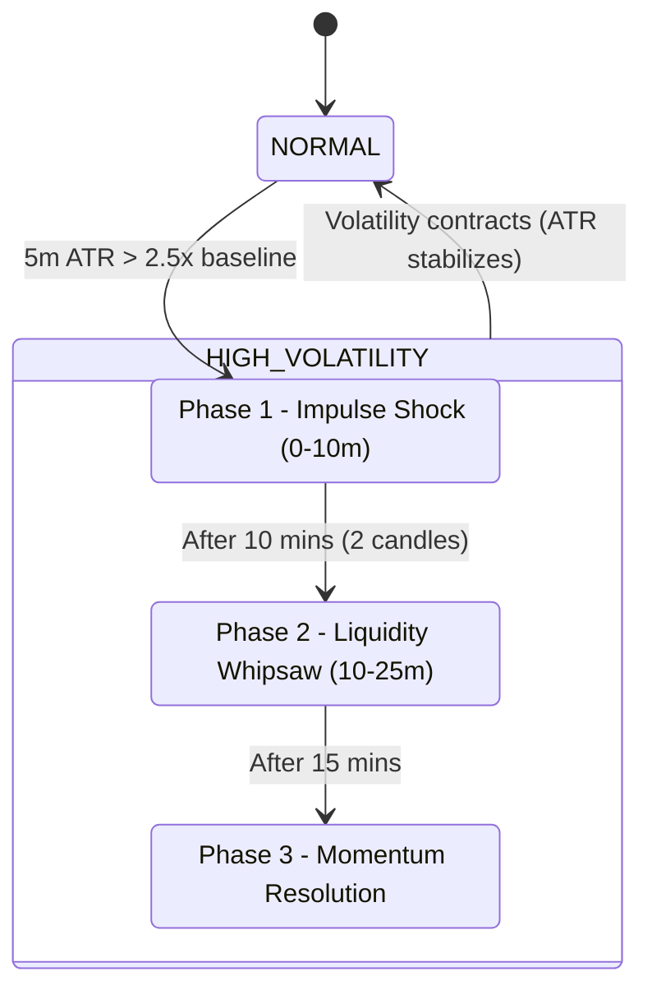

# 02 - Volatility Life-Cycle & Risk Mechanics

Crypto Sentinel is designed specifically for high-leverage perpetual futures trading. Because of this, standard static Stop-Loss values fail during sudden market shocks. Sentinel solves this with a **Dynamic 3-Phase Volatility Life-Cycle** and **ATR-Buffered Liquidation Awareness**.

## The 3-Phase Volatility Cycle

The `RegimeDetector` continuously monitors the 5-minute ATR (Average True Range). If the current 5m ATR expands rapidly beyond 2.5x the baseline, it enters a shock phase.



### Phase Details

1. **PHASE 1: IMPULSE SHOCK (Minutes 0–10)**
   - *Behavior*: A massive green or red candle appears. The market is attempting to stop-hunt tight positions.
   - *Engine Action*: The `PortfolioManager` activates the **Emergency Guard**. If there are any open positions currently in profit with leverage > 10x, their Stop-Loss is instantly moved to Breakeven to protect against the incoming counter-swing. All new signals are hard-blocked.

2. **PHASE 2: LIQUIDITY WHIPSAW (Minutes 10–25)**
   - *Behavior*: The initial move retraces heavily to trap breakout traders.
   - *Engine Action*: New signals are allowed, but the AI Evaluator will apply strict penalties to confidence scores if the setup is "too clean" (assuming it's a trap). 

3. **PHASE 3: MOMENTUM RESOLUTION**
   - *Behavior*: The true trend of the shock establishes itself.
   - *Engine Action*: The engine resumes normal high-volatility trading. Target resolution times (TTL) are shortened dynamically since momentum is fast.

## Risk Management Math

The `RiskManager` prevents liquidation by calculating dynamic thresholds before dispatching a signal.

### Liquidation Zone Avoidance
The engine calculates recent Swing Highs and Swing Lows (over the last 288 periods for 5m). 
- If a Long trade's Stop Loss sits exactly on top of a known `Long Liquidation Zone` (Swing Low), the engine will widen the Stop Loss utilizing an ATR Multiplier to place it *beneath* the liquidation hunting zone.

### Dynamic Leverage Calculation
Rather than trading fixed leverage (e.g., always 20x), leverage is mathematically derived:

```python
# 1. Calculate the percentage distance to the Stop Loss
sl_pct = abs(entry - stop_loss) / entry * 100

# 2. Prevent leverage that would place the liquidation price inside the Stop Loss
max_theoretical_leverage = 100 / sl_pct

# 3. Apply a safety buffer (e.g. 0.85) to ensure SL triggers before liquidation
safe_leverage = max_theoretical_leverage * 0.85
```
This guarantees that the Stop Loss will execute successfully on the exchange before the liquidation engine forcefully liquidates the margin.
